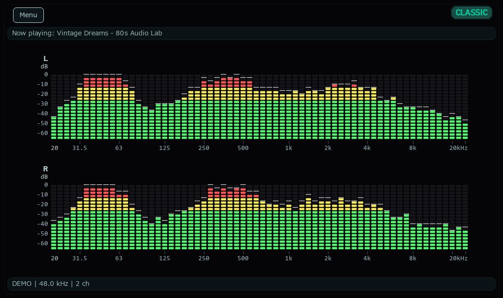

# Wune

[日本語](README.md) / **English**

Wune is an LED audio spectrum analyzer for Windows, macOS, and Linux, inspired by compact stereo systems from the 1980s and 1990s.
Watch the left and right channels respond while listening to music through your usual speakers or headphones.
Customize the colors, LED shapes, layout, and response to the beat in Settings.

Display example rendered by the current application using demo data; it is not a measurement of audio hardware.

## Download and installation

Choose an OS-specific package from [GitHub Releases](https://github.com/yshdsnd/wune/releases). The automatic “Source code” archives are not packaged applications.

- Windows: `Wune-vX.Y.Z-win64.zip` — [Windows installation guide](INSTALL_WINDOWS.en.md)
- Mac: `Wune-vX.Y.Z-macos-arm64.zip` — [macOS installation guide](INSTALL_MACOS.en.md)
- Linux: `Wune-vX.Y.Z-1.x86_64.rpm` / `wune_X.Y.Z_amd64.deb` / `Wune-vX.Y.Z-linux-x64.tar.gz` — [Linux installation guide](INSTALL_LINUX.en.md)

No Python installation is needed. The guides also cover updates, removal, and initial audio permissions.

## Controls

Click the main window before using keyboard shortcuts.

| Action | Function |
| --- | --- |
| F2 (also Command+, on Mac) | Open Settings |
| Alt+Enter / F11 (also Command+F on Mac) | Toggle fullscreen / windowed mode |
| Top-left menu or right-click | Settings, fullscreen, and exit |
| Space | Pause / resume the display; music playback continues |
| T, or left-click the theme name at the top right | Switch to the next color theme |
| I | Show / hide the output information bar |
| Esc | Leave fullscreen; otherwise ask to quit |
| Q | Ask to quit, including in fullscreen |
| Close button or Menu → Exit | Quit immediately |
| Drag the window border | Resize the display |

You can freely resize the window width and height (constrained only by a minimum window size to prevent layout breakdown). Depending on the window's aspect ratio, empty margins may appear around the spectrum. You can eliminate these margins by enabling "Adaptive Fill" or clicking the "Auto-adjust" buttons for "LEDs per bar" and "Bar gap" (or enabling automatic adjustments on resize) in Settings. You can also manually fine-tune the number of LEDs and bar spacing to your preference.
F2 or the menu opens Settings above the main window while keeping fullscreen active. Preview, save, and cancel changes without leaving fullscreen.
While Settings is open, theme changes through T or the theme badge, and information-bar changes through I, are disabled.
The exit prompt defaults to Cancel. Use Tab/arrows to select, Enter/Space to activate, or Esc to cancel. Confirming Exit with "Don't ask again when exiting" disables future prompts. Re-enable them in Settings → General → Confirm before quitting with Q / Esc.

Esc or the close button in the Settings window cancels settings changes rather than quitting the application.

## Settings and customization

Press **F2** to open Settings. Preview changes in real time in the main display while music continues to play.

| Tab | Main settings |
| --- | --- |
| Spectrum | Channel arrangement (separate/mix, stacked/side-by-side), frequency direction, 20 kHz display limit, display gain (dB), LED rendering style/shape/aspect ratio, Adaptive Fill, auto-adjust LEDs/bar gap |
| Info & Text | Scale and info bar font sizes, dynamic font scaling, Now Playing track display, info bar visibility and position |
| Themes and colors | Select, create, duplicate, rename, or delete color themes; edit individual colors |
| Background | Solid color / image, image sizing (Fit / Fill), choose background image |
| Motion | Attack time, release time, peak hold time, and peak fall speed |
| General | Window size presets, display language, exit confirmation prompt |

### Spectrum settings
- **Channel display**: Choose between separate L/R channels or Stereo Mix. Stereo Mix averages left/right power into a single spectrum so opposite-phase signals do not cancel. Signals on only one side appear about 3 dB lower than the same audio on both sides. Switching does not interrupt audio capture.
- **Limit display to 20 kHz**: Focus visualization on the audible range (20 Hz–20 kHz) even on high-sample-rate outputs.
- **Display gain (dB)**: Adjust visual gain from -24.0 dB to +24.0 dB (in 1.0 dB increments). Useful for boosting lower-level sources (e.g., Apple Music) so that the upper and red LEDs light dynamically. Does not affect audio output or RMS calculation; only adjusts visual LED mapping with safe [0.0, 1.0] clamping.
- **LED rendering, shape, and aspect ratio**: Choose flat or beveled box styles, rectangle/rounded/ellipse shapes, and adjust the width-to-height ratio (0.25–8.0).
- **Adaptive Fill and auto-adjust**: Enabling "Adaptive Fill" dynamically eliminates empty margins as the window resizes. Use the "Auto-adjust" buttons next to "LEDs per bar" and "Bar gap" to calculate and apply optimal values for the current window size in a single click (functional even if automatic resizing checkboxes are disabled).

### Info & Text settings
- **Font sizes and dynamic scaling**: Adjust font sizes (10–24 px) for scale labels and the information bar. Enable dynamic font scaling to enlarge text proportionally when the window is expanded.
- **Now Playing track display**: Show current track and artist name in the information bar (supported on Windows via standard media session [GSMTC] across browsers like YouTube, Apple Music, Spotify, etc., and Sony Music Center for PC v2.7.3; on macOS via Apple Music).

### Themes and colors
- Themes store colors only; LED shapes, layout, and motion are saved independently.
- Editing a built-in theme automatically creates a user copy, preserving the original palette. You can also create, duplicate, rename, or delete custom themes.

### Background settings
- Choose a solid color or a local PNG/JPEG image.
- **Fit**: Shows the entire image, filling letterbox margins with the theme background color.
- **Fill**: Scales proportionally to fill the window and crops excess margins centrally.
- Image paths are saved without modifying or copying original files. If an image is missing or cannot be loaded, Wune automatically falls back to a solid background.

### General settings and window size presets
- Apply popular resolution presets such as 640x360, 960x540, 1280x720, or 1920x1080 with a single click.
- Switch display languages (System / English / Japanese) and configure the exit confirmation dialog.

| Button | Behavior |
| --- | --- |
| Save | Write the current changes to disk immediately and close Settings |
| Apply | Confirm changes and keep Settings open; write them to disk on normal exit |
| Cancel / close / Esc | Restore the last applied state, or the state before opening Settings if nothing has been applied |
| Reset display | Preview the default display settings and colors; preserve language, motion settings, and the user theme list |
| Reset motion only | Preview defaults for the four settings on the Motion tab only |

On exit, Wune saves the normal-window size and position and the confirmed display, theme, and motion settings, then restores them at the next launch.

On Windows, if Wune exits in fullscreen, it starts fullscreen on the same monitor only when its Windows monitor identity is uniquely found again. If the monitor is missing, ambiguous, or cannot be identified, Wune starts windowed. Port or driver changes can also change the identity and cause a windowed fallback. Leaving fullscreen restores the saved normal-window position and size.
Mac does not restore fullscreen on the same monitor; it starts windowed.
If you quit with Settings still open, unapplied previews are not saved.

### Switch between English and Japanese

Open F2 → **General**（一般）→ **Language**（表示言語）and select
System / Auto, English, or 日本語. Automatic selection falls back to English for unsupported system languages.
The main display updates immediately. To update the Settings window, use Save to close it, or Apply and then close it, and reopen it with F2.
The standard Windows color picker follows the Windows display language.

## Settings location and reset

On Windows, paste the following into File Explorer. On Mac, use Finder → Go to Folder with `~/Library/Application Support/Wune`:

~~~text
%LOCALAPPDATA%\Wune
~~~

| File | Contents |
| --- | --- |
| settings.json | Display settings, user themes, normal-window geometry, and fullscreen monitor identity |
| Wune.log | Startup and runtime log for the packaged app; overwritten at each launch |

The Settings window also shows the save path at the bottom. To back up your settings, close Wune and copy settings.json.

To reset everything, close Wune, **move settings.json to another location**, then launch Wune.
This also resets user themes and window placement. To restore your backup, close Wune and put the file back.
Corrupt files or unsupported settings formats are left untouched while Wune starts with defaults, so this reset method can also help when settings are not being saved.

To reset from the command line, open PowerShell in the folder containing Wune.exe.
This deletes the existing settings file; back it up first if needed.

~~~powershell
.\Wune.exe --reset-settings
~~~

## Supported environment and limitations

- Hardware-verified environment: Windows 11 x64, macOS 27 Apple Silicon, and Linux (Fedora 44 x64).
- Mac packages target Apple Silicon arm64. Core Audio Process Tap requires macOS 14.2 or later; this does not imply hardware verification on every supported OS version.
- On Linux, hardware verification has only been performed on Fedora 44. RHEL and Ubuntu/Debian packages are provided and smoke-tested in CI but have not been tested on physical hardware; we welcome users who can test them and report any issues on [GitHub Issues](https://github.com/yshdsnd/wune/issues).
- An output device capable of stereo audio playback is required.
- Windows 10 and Windows on ARM have not been tested. No packages are available for 32-bit Windows, Intel Mac, or FreeBSD.
- Audio is captured from the startup default output through WASAPI on Windows, Core Audio Process Tap on Mac, and PulseAudio/PipeWire loopback on Linux. Microphone input and direct audio-file loading are not supported.
- Output-device and sample-rate changes are not followed automatically while Wune is running.
- Capture uses channels 0 and 1. Full surround downmixing and mono-only devices are not supported.
- The Settings window does not include audio-device selection or band-count controls.
- At higher sample rates, the display range extends up to 40 kHz. Use “Limit display to 20 kHz (keep capture rate)” to focus on the audible range.
- Some scale labels are omitted in narrow layouts. Levels are per-band indications, not sound-pressure or true-peak measurements.
- Now-playing track display in the information bar supports Windows Global System Media Transport Controls (GSMTC) and Sony Music Center for PC (verified with v2.7.3) on Windows, Apple Music on macOS, and MPRIS2 (playerctl/DBus) on Linux. Because Music Center for PC metadata is retrieved by parsing its window title, future updates to the player that alter the title format may prevent track information from being displayed.
- Changes to DPI or display configuration while running have not been tested.

## Troubleshooting

| Symptom | What to check |
| --- | --- |
| Wune will not start or closes immediately | Extract the entire ZIP/archive and check that _internal is next to the executable. Check any error message and Wune.log |
| Blocked by a security prompt on launch | On Windows, if prompted with "Windows protected your PC", click "More info" and select "Run anyway" (see the [Windows guide](INSTALL_WINDOWS.en.md)). On macOS, allow Wune in System Settings → Privacy & Security (see the [macOS guide](INSTALL_MACOS.en.md)). For Linux package installations, see the [Linux guide](INSTALL_LINUX.en.md) |
| The spectrum does not move | Resume with Space if paused. Check that audio is playing and that the information bar names the same output device used by your playback app |
| The display stops after switching to headphones or another output | Check the OS output device and restart Wune |
| F2 or other shortcuts do not work | Click the main window first. Check whether Settings is open behind another window |
| Settings revert or are not saved | Use Save, or Apply followed by a normal exit. Check the save path and log; back up and reset settings if necessary |
| Only the Settings window stays in the previous language | Save or apply the language, then close and reopen Settings |

For unresolved problems or feature suggestions, please use **[GitHub Issues](https://github.com/yshdsnd/wune/issues)**.
For bug reports, include:

- Wune version (ZIP filename or the bundled build-info.json) and OS version
- Audio output device name, sample rate shown in the information bar, and steps to reproduce
- Expected and actual behavior, with screenshots if useful
- Any error message and Wune.log captured immediately after the problem

Remove usernames or other information you do not want to share publicly from logs and screenshots.

## Development / running from source

For normal use, choose the ZIP described above.
See the **[developer guide (Japanese)](docs/development.md)** for Python setup, running from source, development settings, and tests.
See the **[packaging guide (Japanese)](docs/packaging.md)** for building the distribution ZIP and checks before publication.

## Credits and license

Wune uses NumPy, pygame / SDL, SoundCard / CFFI, and Python / Tcl / Tk, and is packaged with PyInstaller.
The distribution ZIP includes third-party licenses and notices in the licenses folder.
Its inventory.json records bundled components; sources/ contains corresponding rebuild sources. Windows checks individual DLLs; Mac records hashes of the signed app files, collected inputs, and package notices.
See the **[bundled software notes (Japanese)](packaging/licenses/README.md)** for third-party provenance and redistribution terms.
The custom icon's provenance and creation notes are in the **[icon documentation](https://github.com/yshdsnd/wune/blob/main/wune/assets/README.md)**.

Wune itself is provided under the **[BSD 2-Clause License](LICENSE)**.
Bundled third-party software retains its own licenses; Wune's license does not replace them.
